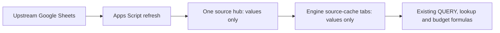

# Linehaul budget source hub

Apps Script replaces external imports. Budget formulas remain in Google Sheets.



The engine never uses a cross-workbook formula to read the hub. Apps Script copies
the hub snapshot into local cache tabs and rewrites only the `IMPORTRANGE(...)`
subexpressions to local A1 references. `QUERY`, `FILTER`, `XLOOKUP`, arrays, trip
rounding, rates and cost arithmetic keep calculating in the engine.

## First run

1. Open the source hub and its **Extensions → Apps Script** editor. Run `setup` and
   authorize access to the source spreadsheets. The Google account running the
   script must be able to read every upstream workbook.
2. On **Control**, set `TEMPLATE_ID` to the existing engine's ID and `LM_SOURCE_ID`
   to the workbook containing `Final Proj (Budget)`.
3. If `ENGINE_ID` is blank, run `createEngineCopy`. It creates a separate working engine and records its ID.
   Refresh refuses to modify the original template.
4. Run `discoverImports`. It scans **all formula rows**, not only the header rows.
   If it checkpoints, run `continueRefresh` until status is `DISCOVERED`.
5. Run `startRefresh`. Run `continueRefresh` whenever the job checkpoints, until
   **Control!B6** is `PUBLISHED`. Check **Refresh Log** for a source-access error,
   unsupported import expression, source error cell, or cell-capacity failure.
6. Compare the working engine's summary and key quantities with the original at
   the same source date. Inputs can have changed since the original last loaded.
7. After a successful manual run, `installRefreshTrigger` schedules a daily run
   around 07:00 WIB and resumes pending work every five minutes. It stops starting
   new jobs after a failure, so inspect the log before retrying.

The script exposes the same actions in the **Budget Sources** menu when the hub
is reopened. No public web app or executable endpoint is deployed.

## What the hub contains

| Tab | Purpose |
| --- | --- |
| Control | Engine IDs, overrides and publication status |
| Refresh Log | Run ID, phase, progress and errors |
| `__Formulas` | Original import formulas and the expected current formula, stored as literal JSON |
| `__Plan` | Source file/tab, projected columns, finite row count and destination bindings |
| `__PendingFormulas` | Compiled formulas for the pending snapshot |
| `__src_*` | Published upstream data, hardcoded values |
| `__stage_*` | Pending upstream data, hardcoded values |
| `manual_*` | Forecast, bulky, vehicle-capacity and distance input tables |

`manual_*` tables are seeded once from the engine's hardcoded inputs. Later
refreshes read these inputs from the hub. Edit the hub tables rather than the
engine input blocks. Preserve the canonical pair ordering and month columns.
The dimensions and bindings are versioned in `src/Config.js`.

Existing manual assumptions and overrides in mixed calculation areas remain in
the engine in this imports-first release. They are not automatically reclassified
as source data or overwritten. The source hub consolidates external dependencies
and the explicitly listed manual input blocks; this is not a port of the entire
budget calculation into JavaScript.

## Sources discovered from the engine

Every live `IMPORTRANGE` is parsed, including nested imports in cost formulas.
Source IDs are resolved from literal URLs, referenced cells, hyperlinks and rich
file chips. If a chip cannot resolve, `SOURCE_OVERRIDES` accepts entries such as:

```json
{"Base Assumptions!B44":"UPSTREAM_SPREADSHEET_ID"}
```

No access tokens or raw source data belong in Git. Source IDs and deployment IDs
are configured in the private hub and local `.clasp.json`, not in committed code.

The existing script-based sources are also included:

| Feed | Upstream selection | Engine destination |
| --- | --- | --- |
| Inner schedule | `Compile Normal Schedule!D3:AQ` | `Schedule v5!A3:AN` |
| DC schedule | Latest `dd mmm yy` tab not after the run date, `A1:AW` | `Schedule DC to DC!A1:AW` |
| FM weights | `FM Average ADO!A3:B` | `RAW_ADO FM Projection!A3:B` |
| LM projections | `Final Proj (Budget)`, columns matched by row-18 header | `RAW_ADO LM Projection!B5:AC` |

Import arguments support literal strings, cell references and `&` concatenation.
Unrecognized expressions fail with the affected import rather than guessing.
Named ranges and `INDIRECT` arguments require an explicit adapter before migration.
Month controls in the original engine are read while planning the run; the resolved
source tabs are pinned for that run. `SOURCE_DATE` changes dated-schedule selection
only. It does not override Air/Sea month controls or `TODAY()` in budget formulas.

The 17 `Base Assumptions!A33:A49` connection canaries query a dummy tab `x`.
They are explicitly retired with an informational formula. The associated source
registry cells, assumptions and actual budget formulas remain intact.

## Refresh and failure behavior

`DISCOVER → DISCOVERED`, then `PLAN → PULL → MANUAL → PUBLISH → COMMITTING → PUBLISHED`.

- Only the columns referenced by imports are cached. Their row coordinates are
  preserved, including blank rows between records.
- Numeric values, booleans and date serials remain typed. `RAW` writes prevent
  text beginning with `=` from becoming an executable formula.
- Open ranges are bounded to the source's used rows. Explicit finite row bounds
  are retained. Trailing unused grid rows are excluded; verify any formula whose
  intended result depends on counting those blank rows.
- Every data chunk is read back and checked before continuing. Source error cells
  fail the refresh; they are not silently converted to zero.
- The job checkpoints before the Apps Script runtime limit and can resume.
- `retryFailedJob` retries a failed checkpoint after the underlying problem is
  resolved. A partial discovery cannot be used to start migration.
- `resumeSources` resumes a pending run or starts the refresh after discovery.
  It also recovers discovery that finished but whose final log write failed.
- Tab creation, lookup, resizing and owned-table reads use Sheets API metadata.
  They do not depend on SpreadsheetApp's potentially stale tab-list cache.
- Pending data is staged in both workbooks. Published tables are replaced and old
  tails cleared in a single Sheets `batchUpdate` per workbook. The engine commits
  last. Two different workbooks cannot share one transaction.
- `__Source_Status!B1` in the engine is the authoritative published run ID. A lost
  commit response is reconciled against it before retrying.
- A user edit to a captured import formula blocks publication. Review the stored
  template instead of silently overwriting the edit.
- Capacity is checked before staging. If the engine plus caches exceeds Google's
  cell limit, trim unused grid space or reduce source scope. No rows are deleted
  automatically to make a refresh fit.

Do not edit engine formula templates or hub source input tables during a run.
The job locks concurrent scripts, but does not prevent human edits in Sheets.
The snapshot is read over time, not an upstream multi-workbook transaction.

## Repository layout

```text
src/Core.js       Formula parser and range/compiler utilities
src/Config.js     Source-feed and manual-input bindings
src/Sheets.js     Values-only I/O, verification and capacity checks
src/Planner.js    Full import discovery and source projection
src/Runner.js     Setup and resumable refresh orchestration
src/Publish.js    Atomic engine publication and recovery
src/Menu.js       Menu and optional time triggers
tests/           Parser, data-integrity and failure-path tests
```

## Development and deployment

```sh
npm run check
npm test
npm install --global @google/clasp
clasp login
clasp push
```

Create `.clasp.json` locally with `scriptId` and `rootDir: "src"` before pushing.
It is gitignored. Use **Apps Script → Run** for initial authorization. `clasp run`
requires additional execution-API configuration and is not required here.
GitHub Actions runs syntax checks and tests. It does not receive Google credentials
or deploy automatically.

For setup, execution and data-write semantics, see the official documentation:
[Sheets RAW values](https://developers.google.com/workspace/sheets/api/reference/rest/v4/ValueInputOption),
[batch updates](https://developers.google.com/workspace/sheets/api/guides/batchupdate),
[Apps Script quotas](https://developers.google.com/apps-script/guides/services/quotas).
